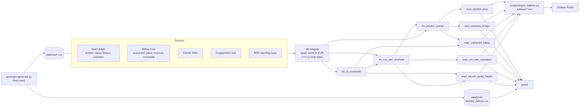

# attrition-lens

One installed-base customer book produces a different gross revenue attrition number depending on what you count as a customer, which date you use, and whose tier you trust. This project measures that spread on the same data and explains every gap with a variance bridge that ties out to the cent. It also surfaces orphaned billing: revenue that keeps billing after a customer has departed.

This is a pattern solved in practice, rebuilt on fully synthetic data. The company (Kestrel Grid, B2B SaaS energy monitoring for commercial buildings, priced per metered site, EUR), its five source systems, every customer and every figure are fictional.

## The counting choices

| Choice | Options | What changes |
|---|---|---|
| **Unit** | `entity` · `group_any` · `group_full` | A legal entity, a holding group as soon as any member departs, or a holding group only once every member has departed |
| **Date** | `status clock` · `contract clock` | The date the Deal Ledger status flipped to Departed, or the contracted departure date |
| **Segment source** | `Deal Ledger tier` · `BRR tier` | Which system's tier (Anchor / Scale / Standard / Starter) the attrition is reported under |

Same book, attrition in 2025:

| Unit | Status clock | Contract clock |
|---|---|---|
| entity | 120 | 107 |
| group_any | 93 | 80 |
| group_full | 81 | 70 |

## Headline bridge

Output of `make headline`:

```
A = 78 groups (EUR 2,365,524.00), counted by entity status flipped to Departed in 2023, Deal Ledger tier, member entities excluded
B = 76 = 78 - 11 rebounds (out) - 8 entity transfers (out) + 11 status lag (in) + 10 member-only departures (in) - 5 tier source mismatch (out) + 5 tier source mismatch (in) - 4 clock-year shift (out), counted by contract clock in 2023, group_any, BRR tier, entity transfers excluded
    run-rate: EUR 3,362,160.00 = EUR 2,365,524.00 + EUR 107,820.00 group moves + EUR 888,816.00 member run-rate that Basis A excludes   [ties out: count yes, EUR yes]

A = 83 groups (EUR 2,505,816.00), counted by entity status flipped to Departed in 2024, Deal Ledger tier, member entities excluded
B = 80 = 83 - 11 rebounds (out) - 8 entity transfers (out) - 5 status lag (out) + 11 status lag (in) + 10 member-only departures (in) - 5 tier source mismatch (out) + 5 tier source mismatch (in) - 4 clock-year shift (out) + 4 clock-year shift (in), counted by contract clock in 2024, group_any, BRR tier, entity transfers excluded
    run-rate: EUR 4,531,584.00 = EUR 2,505,816.00 + EUR 595,824.00 group moves + EUR 1,429,944.00 member run-rate that Basis A excludes   [ties out: count yes, EUR yes]

A = 83 groups (EUR 2,949,528.00), counted by entity status flipped to Departed in 2025, Deal Ledger tier, member entities excluded
B = 80 = 83 - 11 rebounds (out) - 8 entity transfers (out) - 5 status lag (out) + 11 status lag (in) + 10 member-only departures (in) - 5 tier source mismatch (out) + 5 tier source mismatch (in) - 4 clock-year shift (out) + 4 clock-year shift (in), counted by contract clock in 2025, group_any, BRR tier, entity transfers excluded
    run-rate: EUR 3,732,360.00 = EUR 2,949,528.00 + EUR 24,936.00 group moves + EUR 757,896.00 member run-rate that Basis A excludes   [ties out: count yes, EUR yes]
```

Basis A is the number a status-based report produces. Basis B is the contract-based, group-level number on the reporting layer's tier. Each group that is in one basis and not the other carries exactly one reason code, assigned by a fixed priority. Definitions are in [docs/methodology.md](docs/methodology.md).

## Data flow



## Planted defects and how each is detected

| # | Defect planted in the synthetic data | Detected by |
|---|---|---|
| 1 | Deal Ledger departure date is exclusive, Billing Core term end inclusive: a naive compare is off by one day | `mart_source_parity_health`, check `end_date_convention`: aligned after `last_service_date = departure_date - 1` |
| 2 | Rebounds: flipped to Departed, then back to Active | `int_attrition_events.rebound_flag`; bridge reason `rebound` |
| 3 | Entity transfers booked as departures | `int_attrition_events.entity_transfer_flag`; bridge reason `entity_transfer` |
| 4 | Partial group loss, including groups spanning tiers | Bridge reason `member_only_departure` (addition), `detail = cross_tier` |
| 5 | Deal Ledger tier differs from BRR tier | `mart_source_parity_health`, check `tier_source`; bridge reason `tier_source_mismatch` |
| 6 | Status lag (flip missing or late) and clock-year shifts | `int_attrition_events.clock_alignment`; bridge reasons `status_lag`, `clock_year_shift` |
| 7 | Orphaned billing: Departed but still billing | `mart_orphaned_billing` (`active_plan` / `post_departure_invoice`) |
| 8 | Invoices at 23:00–23:59 UTC whose local date is the departure date | `mart_source_parity_health`, check `clock_boundary`; `mart_orphaned_billing.caught_by_utc_compare = false` |
| 9 | Billing IDs as comma lists and `"; "` crosswalk pairs | `int_id_crosswalk.link_path`; parity check `billing_link` |
| 10 | Naive run-rate lookup blank for Billing-Core-keyed and Partner Biller customers | `mart_run_rate_resolution.resolution_outcome`; parity check `partner_biller_gap` |
| 11 | Duplicate Engagement Hub contacts on (email, entity) | Parity check `duplicate_contact`: keep the most tasks + conversations, delete the rest; a different email is kept |

## How to run

Requires Python 3.11+ and `make`. On macOS, in the VS Code integrated terminal:

```bash
git clone https://github.com/erikroa/attrition-lens.git
cd attrition-lens
python3 -m venv .venv
source .venv/bin/activate
pip install -r requirements.txt
make all
```

`make all` runs, in order:

| Target | What it does |
|---|---|
| `make generate` | Writes `data/raw/*.csv` and `data/truth/planted_defects.csv`. Deterministic: same seed, same bytes. |
| `make dbt` | `dbt build`: all models and all dbt tests, into a local DuckDB file `dbt/attrition_lens.duckdb`. |
| `make export` | One CSV per mart into `tableau/`. |
| `make test` | pytest: truth manifest, UTC vs local dates, tie-out, banned words. |
| `make headline` | Prints the bridge equations above; exits non-zero if any year fails to tie out. |

## Tests

**dbt** (`make dbt`):
- unique and not_null on every key
- accepted_values on every enum
- relationships between sources and models
- `assert_variance_bridge_ties_out`: Basis A + movements = Basis B, in count and to the cent, per year × tier and per year
- `assert_no_unexplained_bridge_rows`

**pytest** (`make test`):
- every mart's detections match the planted truth manifest exactly: same IDs, same labels, no extras, no misses
- a UTC date compare misses the clock-boundary invoices, and the local date compare catches them
- the bridge ties out to the cent for every year
- the repo contains none of the banned vocabulary

CI (`.github/workflows/ci.yml`) runs generate → dbt build → export → pytest → headline on every push.

## Dashboards

Tableau Public: _link to be added_

<!-- Screenshots: docs/img/1-attrition-overview.png, 2-variance-bridge.png, 3-orphaned-billing.png, 4-source-parity-health.png -->

Build steps, click by click, are in [tableau/DASHBOARD_SPEC.md](tableau/DASHBOARD_SPEC.md).

## Repo layout

```
generator/generate.py        synthetic sources + truth manifest
dbt/                         staging -> intermediate -> marts, schema and custom tests
scripts/export_tableau.py    marts -> tableau/*.csv
scripts/print_headline.py    bridge equation lines
tableau/                     exported CSVs + DASHBOARD_SPEC.md
docs/methodology.md          definitions and rules
tests/                       pytest verification
```

## License

MIT
